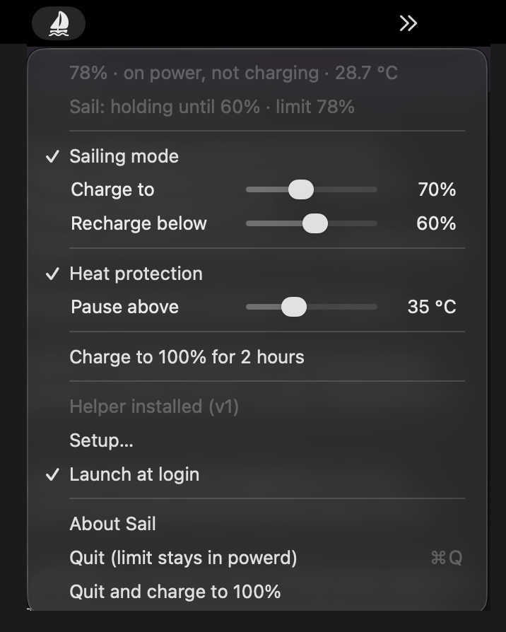
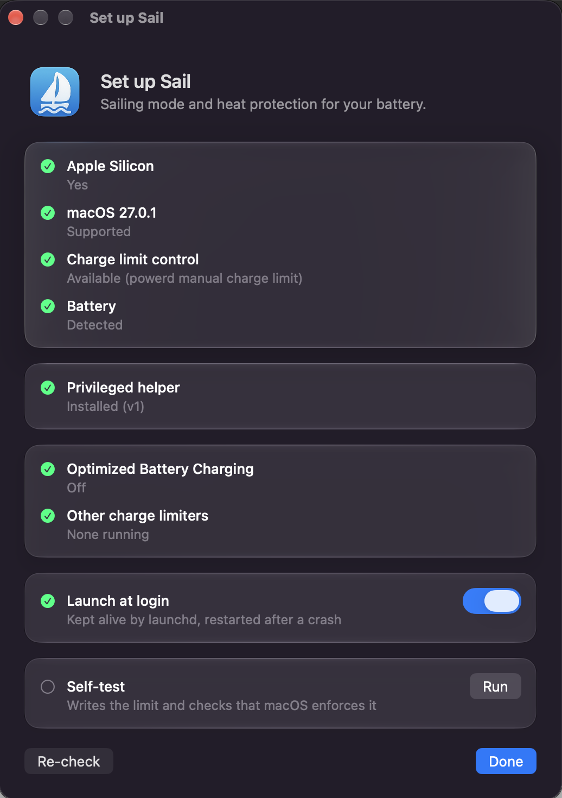

# Sail

A small, boring battery charge limiter for Apple Silicon MacBooks. It does two things:

- **Sailing mode** — charge to an upper limit, then do not top up again until the battery
  has drained to a lower limit.
- **Heat protection** — pause charging while the battery is hot.

It lives in the menu bar, starts at login, is restarted by launchd if it ever crashes, and
the limit it sets survives sleep, lid close and the app not running, because it is enforced
by macOS itself.

<p align="center">
  
</p>

Everything lives in one menu. The first two lines show the battery and what Sail is
doing right now ("holding until 60%" means the limit follows the battery down and
charging resumes at 60%). *Charge to* and *Recharge below* are the Sailing bounds,
*Pause above* is the heat threshold. "Charge to 100% for 2 hours" suspends Sailing for a
trip. The two Quit items differ in what they leave behind: the limit, or a normal
charge to full.

<p align="center">
  
</p>

The Setup window opens on first launch and from the menu. Every row is a check that can
be re-run; the self-test writes the limit and confirms that macOS enforces it.

## Requirements

- Apple Silicon MacBook.
- macOS 26.4 or newer (the first version with a built-in manual charge limit).
- Optimized Battery Charging turned off in System Settings → Battery.
- Not running at the same time as AlDente or batt.

Intel Macs and older macOS are not supported: the charge-control keys they used are gone
or locked on current firmware. See [docs/DESIGN.md](docs/DESIGN.md) for the measurements.

## Install

With [Homebrew](https://brew.sh):

```bash
brew install --cask jiraffekiller/tap/sail-battery
```

Or download `Sail-vX.Y.Z.zip` from [Releases](../../releases), unzip and move `Sail.app`
to `/Applications`.

The build is ad-hoc signed, not notarized, so macOS blocks the first launch. Allow it
under System Settings → Privacy & Security → *Open Anyway*, or clear the quarantine flag
once:

```bash
xattr -dr com.apple.quarantine /Applications/Sail.app
```

The Setup window walks through the rest: it installs the privileged helper (one
administrator password), checks the settings that conflict with a charge limit, enables
launch at login and runs a self-test.

Or build from source with the Xcode command line tools:

```bash
make test        # unit tests for the policy
make install     # build, copy to /Applications, install the helper, enable launch at login
```

## How it works

macOS 26.4 added a manual charge limit that `powerd` enforces in firmware; System Settings
only exposes 80–100 %. Sail drives that mechanism directly:

- 80–100 % through the private `PowerUI.framework` client, as a normal user.
- Any value through a root helper with exactly one method: write `mclLimitValue` into
  PowerUIAgent's preferences and post the notification that makes it re-read them.

`powerd` charges up to the limit, holds there, and drains down to it if the battery is
above it. Sail's Sailing mode is a tiny state machine on top: *charging* sets the limit to
the upper bound; *holding* sets it to the current percentage so a re-plugged Mac never tops
up; dropping below the lower bound switches back to *charging*. Heat protection is the same
hold while the battery is above the threshold. Below 20 % charging is always allowed.

The app itself is a desired-state loop: every 30 seconds and on every power event it reads
the battery, asks the policy for the limit, compares with what `powerd` enforces and writes
only on a difference.

## Diagnostics

```bash
/Applications/Sail.app/Contents/MacOS/Sail --status
/usr/bin/log stream --style compact --predicate 'subsystem == "com.jiraffekiller.sail"'
```

Please paste the `--status` output into bug reports.

## Uninstall

`brew uninstall --cask sail-battery` (add `--zap` to delete settings too), `make uninstall` from a
source checkout, or by hand: quit Sail, delete `/Applications/Sail.app`,
`~/Library/LaunchAgents/com.jiraffekiller.sail.agent.plist`, and run
`sudo sh /Applications/Sail.app/Contents/Resources/uninstall-helper.sh` before deleting the app.

## Caveats

- Uses a private Apple framework. It is the same one System Settings uses, and the
  self-test tells you if a macOS update breaks it, but there is no guarantee.
- macOS runs its own battery calibration every few days and charges to 100 % regardless of
  any limit. Sail does not fight it; it holds at the new level and resumes Sailing from there.
- The helper only accepts connections from a process signed with Sail's bundle identifier.
  Builds are ad-hoc signed, so treat that as a courtesy check, not a security boundary.

## License

GPL-3.0. © 2026 JiraffeKiller. Built with help from Claude Code.
